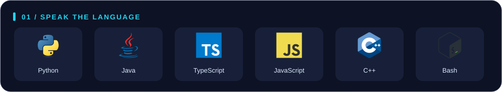
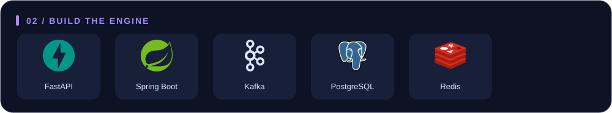
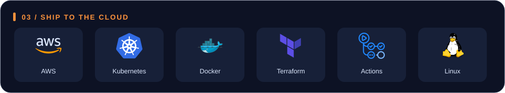
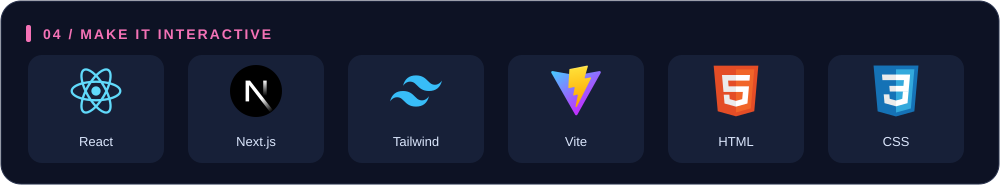
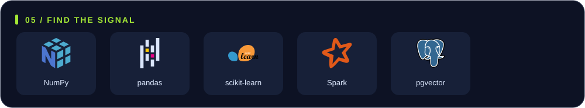
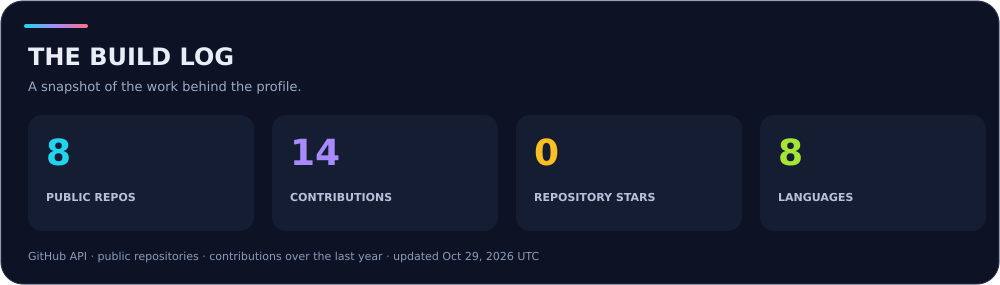
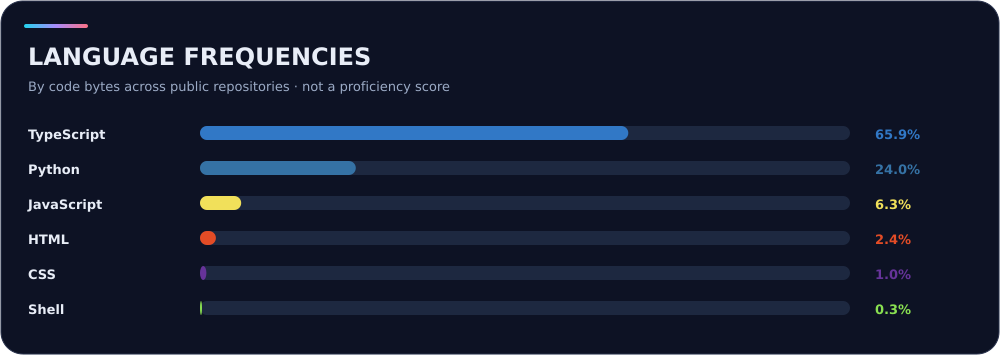
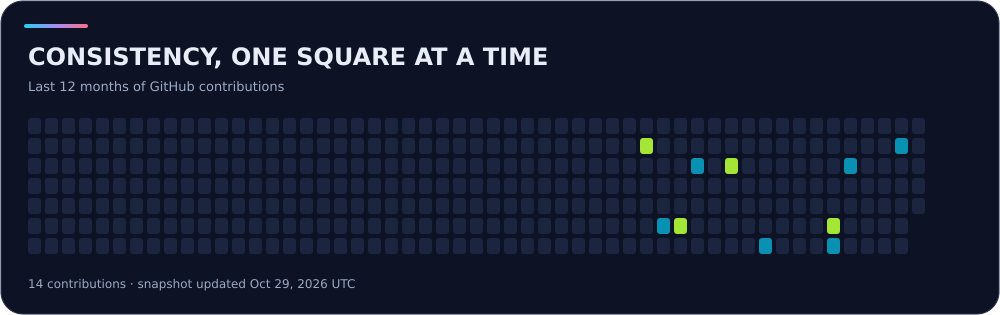

  

  <a href="#-the-person-behind-the-code">About</a> &nbsp; / &nbsp;
  <a href="#-selected-builds">Projects</a> &nbsp; / &nbsp;
  <a href="#-technical-toolkit">Toolkit</a> &nbsp; / &nbsp;
  <a href="#-github-insights--statistics">GitHub Insights</a> &nbsp; / &nbsp;
  <a href="#-lets-connect">Connect</a>

  
  
  
  

## 👋 The person behind the code

I’m **Rajashekar**, a software engineer focused on resilient backends, cloud platforms, information retrieval, and useful AI applications. I enjoy connecting the pieces: the service behind the API, the data behind the recommendation, and the interface that makes it all understandable.

- ⚙️ **Engineering:** Distributed systems, event-driven services, and cloud-native architecture.
- 🧠 **Exploring:** Hybrid search, retrieval-augmented generation, and applied machine learning.
- 🎓 **Academic background:** Data Science at the University at Buffalo, SUNY.
- 📍 **Based in:** Buffalo, New York.

> **My favorite kind of project:** a difficult problem with a clear, useful experience on the other side.

## 🚀 Selected builds

<table>
<tr>
<td width="50%" valign="top">

### 🔥 Comment Pulse
**Understand the conversation behind the sentiment.**

A colorful social-comment analytics prototype with topic exploration, sentiment filters, custom comment analysis, and CSV exports. Browser-side keyword rules power the demo.

**React · TypeScript · Recharts · Tailwind CSS**

[Explore the project ↗](https://github.com/rajashekarakula19-spec/comment-pulse-dashboard)

</td>
<td width="50%" valign="top">

### 🍽️ FooLover
**From “what’s for dinner?” to a complete plan.**

A Buffalo dinner planner combining restaurant discovery, meal building, bill estimates, and itineraries. Includes an optional local AI service and a frontend demo mode.

**React · FastAPI · MapLibre · Ollama**

[Explore the project ↗](https://github.com/rajashekarakula19-spec/Foolover)

</td>
</tr>
<tr>
<td width="50%" valign="top">

### 📦 ShelfSignal
**See inventory risk before the shelf goes empty.**

Retail stockout prediction and operations analytics with explainable warning signals, a dashboard, and a grounded assistant.

**Python · FastAPI · React · Machine Learning**

[Explore the project ↗](https://github.com/rajashekarakula19-spec/retail-stockout-early-warning)

</td>
<td width="50%" valign="top">

### 🛡️ FraudSentinel
**Make risk visible—and predictions explainable.**

Fraud detection with cost-sensitive LightGBM, feature attribution, a FastAPI service, and an interactive analytics interface.

**LightGBM · SHAP · FastAPI · React**

[Explore the project ↗](https://github.com/rajashekarakula19-spec/frictionless-fraud-detection)

</td>
</tr>
</table>

## 🛠️ Technical Toolkit

**Different layers. One connected engineering toolkit.**

  
  
  
  
  
  

  
  
  
  

Tool logos: [Devicon](https://github.com/devicons/devicon). Technologies reflect my projects and engineering interests.

## 📊 GitHub Insights & Statistics

**A look at what I’m building, in code and contributions.**

  
  
  

Generated from GitHub’s API and refreshed weekly through [GitHub Actions](.github/workflows/profile-stats.yml). Language percentages measure code bytes in public repositories, not skill level. Each graphic shows its data scope; activity covers the last twelve months.

## 📬 Let’s connect

I’m always happy to talk about backend engineering, cloud systems, search, and turning an idea into a working product.

  
  
  

