  

  <a href="#-about-me">About</a> &nbsp;·&nbsp;
  <a href="#-proven-production-impact">Production Impact</a> &nbsp;·&nbsp;
  <a href="#-featured-systems--projects">Featured Systems</a> &nbsp;·&nbsp;
  <a href="#-technical-toolkit">Technical Toolkit</a> &nbsp;·&nbsp;
  <a href="#-github-insights">Activity</a> &nbsp;·&nbsp;
  <a href="#-get-in-touch">Contact</a>

  
  
  
  

---

## 🧭 About Me

<table>
  <tr>
    <td width="150" align="center" valign="middle">
      
    </td>
    <td valign="top">
      I am a <b>Software Development Engineer</b> with <b>3+ years of experience</b> architecting high-availability distributed systems, cloud-native microservices, and information retrieval pipelines on <b>AWS</b>.  
      🎓 <b>Graduate Researcher &amp; Master's Student</b> at the <b>University at Buffalo, The State University of New York</b> (M.S. in Data Science, <i>Graduating May 2026</i>). 
      ⚙️ <b>Core Focus:</b> Resilient backend platforms, hybrid search combining keyword + dense vector retrieval, and decoupled event-driven systems (Kafka, Kubernetes, FastAPI). 
      📍 <b>Location:</b> Buffalo, NY (Actively open to on-site and remote opportunities across the US).
    </td>
  </tr>
</table>

---

## ⚡ Proven Production Impact

<table>
  <tr>
    <td width="33%" align="center">
      <h3 style="margin: 0; color: #E5B5C7;">300K+ Tx / Day</h3>
      Microservices on AWS EKS with <b>99.9%+ availability</b> &amp; Kafka async decoupling at Accenture.
    </td>
    <td width="33%" align="center">
      <h3 style="margin: 0; color: #E5B5C7;">$750M Portfolio</h3>
      Real-time fraud monitoring backend &amp; sub-50ms XGBoost inference at I Ray IT Solutions.
    </td>
    <td width="33%" align="center">
      <h3 style="margin: 0; color: #E5B5C7;">600+ Hours Saved</h3>
      Monthly analyst time saved with AST query sandboxing &amp; hybrid SQL + RAG pipelines.
    </td>
  </tr>
</table>

---

## 🚀 Featured Systems & Projects

<table>
  <tr>
    <td width="50%" valign="top">

### 🔍 [InsightQuery AI](https://github.com/rajashekarakula19-spec/insightquery-ai)
**Enterprise Hybrid SQL + RAG Analytics Platform**

Translates complex natural language business questions into schema-aware relational queries while retrieving deep domain context using 384-dim semantic embeddings.

* Integrated a read-only **AST execution sandbox** and multi-source synthesizer to accelerate ad-hoc turnarounds by ~30%.
* Prevents SQL injection and hallucination via strict relational schema binding and vector similarity gating.

<b>Tech:</b> Python · FastAPI · FAISS · LangChain · LLMs · SQL · AST Parsing 
[View Repository ↗](https://github.com/rajashekarakula19-spec/insightquery-ai)

</td>
<td width="50%" valign="top">

### 💬 [CommentPulse](https://github.com/rajashekarakula19-spec/comment-pulse-dashboard)
**Real-Time Social Comment Intelligence & Sentiment Platform**

Engineered an Aspect-Based Sentiment Analysis (ABSA) system clustering 10,000+ unstructured social comments into semantic dimensions (Pricing, UX, Quality).

* Uses **pgvector** and **HDBSCAN clustering** to pinpoint exact root causes behind post virality versus customer backlash.
* Real-time React + TypeScript dashboard with automated spam filtering and sub-100ms multi-dimensional drill-downs.

<b>Tech:</b> Python · pgvector · HDBSCAN · React · TypeScript · Recharts 
[View Repository ↗](https://github.com/rajashekarakula19-spec/comment-pulse-dashboard)

</td>
</tr>
<tr>
<td width="50%" valign="top">

### 📦 [ShelfSignal](https://github.com/rajashekarakula19-spec/retail-stockout-early-warning)
**Retail Inventory Risk & Grounded RAG Assistant**

Seven-day stockout risk prediction and inventory intelligence combining machine learning forecasting with a locally grounded LLM assistant.

* Lead-time-aware risk classification with temporal backtesting and baseline evaluation.
* Interactive operations dashboard featuring evidence citations and explainable warning signals.

<b>Tech:</b> XGBoost · FastAPI · React · Ollama · Scikit-Learn 
[View Repository ↗](https://github.com/rajashekarakula19-spec/retail-stockout-early-warning) · [Interactive Dashboard ↗](https://rajashekarakula19-spec.github.io/retail-stockout-early-warning/)

</td>
<td width="50%" valign="top">

### ⚡ [Voltart](https://github.com/rajashekarakula19-spec/industrial-energy-analytics-and-electricity-demand-forecasting)
**Industrial Energy Analytics & Demand Forecasting**

End-to-end industrial electricity demand forecasting system providing 14-day rolling demand predictions and cost anomaly detection.

* Backtested regression models evaluating peak-load volatility and rate structures.
* High-performance Next.js interface for industrial plant cost simulations.

<b>Tech:</b> Python · scikit-learn · Next.js · TypeScript · FastAPI 
[View Repository ↗](https://github.com/rajashekarakula19-spec/industrial-energy-analytics-and-electricity-demand-forecasting)

</td>
</tr>
</table>

---

## 🛠️ Technical Toolkit

<table>
  <tr>
    <td width="22%" valign="top"><b>Languages</b></td>
    <td>
      
      
      
      
      
      
    </td>
  </tr>
  <tr>
    <td valign="top"><b>Backend &amp; Distributed</b></td>
    <td>
      
      
      
      
      
      
    </td>
  </tr>
  <tr>
    <td valign="top"><b>Cloud &amp; DevOps</b></td>
    <td>
      
      
      
      
      
      
    </td>
  </tr>
  <tr>
    <td valign="top"><b>Search, Data &amp; AI</b></td>
    <td>
      
      
      
      
      
      
      
      
    </td>
  </tr>
  <tr>
    <td valign="top"><b>Observability &amp; QA</b></td>
    <td>
      
      
      
      
      
      
    </td>
  </tr>
</table>

---

## 📅 GitHub Contribution Heatmap

  

---

## 📊 GitHub Insights &amp; Statistics

  
  &nbsp;
  

---

## 📬 Get In Touch

Whether discussing scalable cloud backends, search pipelines, or distributed system design, I'm always open to connecting:

  
  &nbsp;
  
  &nbsp;
  

---

  

